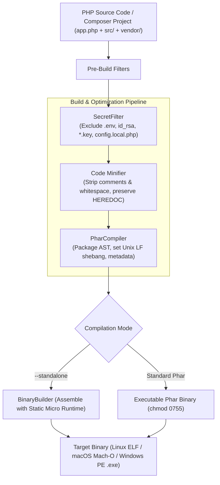

# 📦 PHP-to-Binary

<div align="center">

```
  ██████╗ ██╗  ██╗██████╗     ████████╗ ██████╗     ██████╗ ██╗███╗   ██╗ █████╗ ██████╗ ██╗   ██╗
  ██╔══██╗██║  ██║██╔══██╗    ╚══██╔══╝██╔═══██╗    ██╔══██╗██║████╗  ██║██╔══██╗██╔══██╗╚██╗ ██╔╝
  ██████╔╝███████║██████╔╝       ██║   ██║   ██║    ██████╔╝██║██╔██╗ ██║███████║██████╔╝ ╚████╔╝ 
  ██╔═══╝ ██╔══██║██╔═══╝        ██║   ██║   ██║    ██╔══██╗██║██║╚██╗██║██╔══██║██╔══██╗  ╚██╔╝  
  ██║     ██║  ██║██║            ██║   ╚██████╔╝    ██████╔╝██║██║ ╚████║██║  ██║██║  ██║   ██║   
  ╚═╝     ╚═╝  ╚═╝╚═╝            ╚═╝    ╚═════╝     ╚═════╝ ╚═╝╚═╝  ╚═══╝╚═╝  ╚═╝╚═╝  ╚═╝   ╚═╝   
```

**Compile any PHP script or Composer project into a single, standalone executable binary with embedded runtime — Zero host PHP dependencies required.**

[](https://www.php.net/)
[](LICENSE)
[](tests/)
[](#-cross-compilation-matrix)
[](action.yml)

[Why PHP-to-Binary?](#-why-php-to-binary) •
[Features](#-key-features) •
[Architecture](#-architecture) •
[Quickstart](#-quickstart) •
[Cross-Compilation](#-cross-compilation-matrix) •
[Comparison](#-comparison-matrix) •
[GitHub Action](#-github-actions-cicd)

</div>

---

### ⚠️ The Problem: Distributing PHP CLI Tools

PHP is one of the most productive languages for building developer tools, CLI utilities, migration scripts, and automation daemons. However, distributing them to users has always been frustrating:
* **The "Install PHP First" Barrier**: End users, DevOps teams, and clients often don't have PHP installed, or have the wrong version (PHP 7.4 vs 8.3), or are missing required extensions (`ext-mbstring`, `ext-curl`, `ext-json`).
* **Phar Limitations**: Traditional Phar files (like Composer or tools built with Box) still require a pre-installed host PHP runtime to execute.
* **Go & Rust Advantage**: Languages like Go and Rust became dominant for CLI tools primarily because of `go build` / `cargo build`—producing a single portable executable that runs immediately.

---

### 💡 The Solution: PHP-to-Binary

**PHP-to-Binary** brings the `go build` developer experience to the PHP ecosystem:
1. **100% Standalone (`--standalone`)**: Embeds a high-performance, statically compiled micro-PHP runtime directly into your binary. Users can run your tool immediately without installing PHP.
2. **True Cross-Compilation**: Build for **Linux (x86_64 / aarch64)**, **macOS (Apple Silicon arm64 / Intel x86_64)**, and **Windows (.exe)** from any development machine.
3. **Zero-Friction Execution**: Automatically detects and manages `phar.readonly=0` without requiring developers to remember obscure CLI flags.
4. **Production Code Minification**: Built-in PHP tokenizer minifier strips comments and whitespace, reducing binary size while preserving HEREDOC, NOWDOC, and regexes.
5. **Zero-Trust Secret Shield**: Automatically detects and strips `.env`, SSH private keys (`id_rsa`, `id_ed25519`), certificates (`.pem`, `.key`), and local configuration files.

---

### 🏛️ Architecture



---

### ⚡ Quickstart

#### 1. Global Installation:
```bash
composer global require anton-barinov/php-to-binary
```

#### 2. Compile Your First Script:

Create a simple script `hello.php`:
```php
<?php
echo "Hello from standalone compiled binary! Running on PHP " . PHP_VERSION . "\n";
```

Compile into a standalone executable:
```bash
# 1. Compile into an autonomous standalone binary:
php-to-binary build hello.php --standalone --output=hello-cli

# 2. Execute directly (no host PHP required):
./hello-cli
```

---

### 🌐 Cross-Compilation Matrix

Build binaries for any operating system using `--target`:

| Target Platform | Architecture | Output Format | Command Example |
|---|---|---|---|
| **Linux (x86_64)** | 64-bit Intel/AMD | Linux ELF | `php-to-binary build app.php --standalone --target=linux-x86_64 -o dist/tool-linux` |
| **Linux (ARM64)** | 64-bit aarch64 (Raspberry Pi, Graviton) | Linux ELF | `php-to-binary build app.php --standalone --target=linux-aarch64 -o dist/tool-arm64` |
| **macOS (Apple Silicon)** | arm64 (M1/M2/M3/M4) | Mach-O 64-bit | `php-to-binary build app.php --standalone --target=macos-arm64 -o dist/tool-mac-arm` |
| **macOS (Intel)** | x86_64 | Mach-O 64-bit | `php-to-binary build app.php --standalone --target=macos-x86_64 -o dist/tool-mac-intel` |
| **Windows** | x86_64 | PE Executable (`.exe`) | `php-to-binary build app.php --standalone --target=windows-x64 -o dist/tool.exe` |

---

### 📊 Comparison Matrix

| Feature | **PHP-to-Binary** | Traditional Phar (Box) | FrankenPHP CLI | Go (`go build`) |
|---|---|---|---|---|
| **Zero Host PHP Required** | ✅ **YES (`--standalone`)** | ❌ No (requires PHP) | ✅ Yes | ✅ Yes |
| **Windows `.exe` Generation** | ✅ **YES** | ❌ Requires php.exe | ⚠️ Experimental | ✅ Yes |
| **Cross-Compilation from macOS to Linux** | ✅ **YES** | ❌ No | ⚠️ Complex Docker | ✅ Yes |
| **Automatic `phar.readonly` Self-Respawn** | ✅ **YES** | ❌ Manual CLI flags | N/A | N/A |
| **Secret Exfiltration Filter (`.env`, keys)** | ✅ **YES (Built-in)** | ⚠️ Manual config | ❌ No | ❌ Manual |
| **Built-in Tokenizer Minifier** | ✅ **YES** | ⚠️ External plugins | ❌ No | ✅ Compiler strips |
| **Output File Format** | **Single Executable** | Archive / Phar | Embedded Binary | Native Binary |

---

### 💻 CLI Command Reference

```bash
# 1. Compile script into standalone binary with minification
php-to-binary build entrypoint.php --standalone --minify -o my-app

# 2. Include additional source and vendor directories
php-to-binary build bin/console.php --include=src,vendor --standalone -o release/console

# 3. Cross-compile for Linux from a Mac
php-to-binary build main.php --standalone --target=linux-x86_64 -o dist/my-tool-linux

# 4. Check system compilation capabilities
php-to-binary doctor

# 5. List all available cross-compilation architectures
php-to-binary targets

# 6. JSON output for automated build pipelines
php-to-binary build main.php --json
```

---

### 🤖 GitHub Actions CI/CD

Compile and release your PHP tools in GitHub Actions across all platforms automatically:

```yaml
name: Compile Standalone Binaries

on:
  push:
    tags: ['v*']

jobs:
  build-binaries:
    runs-on: ubuntu-latest
    strategy:
      matrix:
        target: [linux-x86_64, linux-aarch64, macos-arm64, windows-x64]
    steps:
      - name: Checkout code
        uses: actions/checkout@v4

      - name: Setup PHP
        uses: shivammathur/setup-php@v2
        with:
          php-version: '8.3'

      - name: Compile Standalone Binary
        uses: Anton-Barinov/PHP-to-Binary@main
        with:
          entrypoint: 'bin/console.php'
          standalone: 'true'
          target: ${{ matrix.target }}
          output: 'dist/cli-${{ matrix.target }}'
```

---

### 🔗 Related Open-Source Projects by Anton Barinov

- **[Composer-Audit-ZeroTrust](https://github.com/Anton-Barinov/Composer-Audit-ZeroTrust)**: Supply-Chain Security & Typosquatting Auditor for Composer dependencies.
- **[EOL-PHP-Armor](https://github.com/Anton-Barinov/EOL-PHP-Armor)**: 1-line automated security hub & hotpatching engine for EOL PHP (5.4–8.1).
- **[PHP-Hardening-Kit](https://github.com/Anton-Barinov/PHP-Hardening-Kit)**: Modular defense-in-depth runtime WAF security kit for PHP.
- **[php2shell-patches](https://github.com/Anton-Barinov/php2shell-patches)**: The original viral repository providing C-patches for CVE-2026-109618 / 19.
- **[Single-PHP](https://github.com/Anton-Barinov/Single-PHP)**: Original prototype Phar packager and engine framework.

---

### 📄 License

This project is licensed under the [MIT License](LICENSE) — created and maintained by **Anton Barinov**.
Pull requests, cross-compilation contributions, and feature ideas are warmly welcome!
